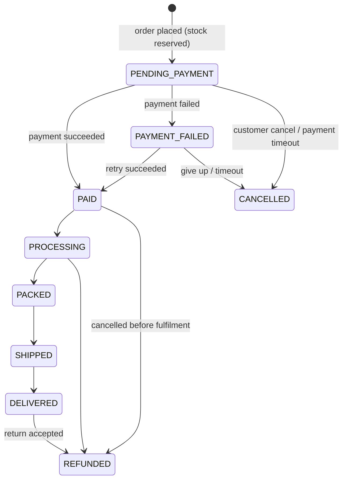

# Domain Model

## Aggregates

| Aggregate | Root | Invariants |
|---|---|---|
| User | `User` | unique email; roles non-empty |
| Product | `Product` (+ variants, options, images) | slug unique; published product has ≥1 active variant with price > 0 |
| InventoryItem | `InventoryItem` (per variant) | `0 ≤ reserved ≤ on_hand` |
| Cart | `Cart` | quantity 1..99 per line; one line per variant |
| Order | `Order` (+ items) | totals = Σ lines − discount + shipping + tax; transitions only via state machine |
| Payment | `Payment` | one SUCCEEDED payment per order; refunds ≤ captured amount |
| Coupon | `Coupon` | used_count ≤ usage_limit; within date window |

## Order state machine



- Transitions live in one place (`OrderStatus.canTransitionTo`), unit-tested exhaustively.
- Every transition writes `order_status_history` in the same transaction and records an outbox event.
- Side effects on inventory:
  - enter `PENDING_PAYMENT` → **reserve**
  - enter `PAID` → **commit** (on_hand −= q, reserved −= q, sold += q)
  - enter `CANCELLED` from unpaid states → **release** (reserved −= q)
  - enter `REFUNDED` → optional **return** to stock (admin choice)
- A scheduled job cancels `PENDING_PAYMENT` / `PAYMENT_FAILED` orders whose reservation expired (default 30 min).

## Inventory

**Strategy: atomic conditional update** (decision D-02).

```sql
UPDATE inventory_items
SET    reserved = reserved + :qty, updated_at = now()
WHERE  variant_id = :variantId
AND    on_hand - reserved >= :qty;
-- 1 row  → reserved
-- 0 rows → insufficient stock → whole checkout transaction rolls back
```

Why this over the alternatives:
- vs. `@Version` optimistic locking: no retry storms on hot items; the DB decides in one statement.
- vs. `SELECT … FOR UPDATE`: no lock held while Java code runs; same row-level serialization, shorter.
- `CHECK (reserved <= on_hand)` is a second safety net — even a buggy code path cannot oversell.
- Multi-line orders reserve variants **in ascending `variant_id` order** to avoid deadlocks.

Required test: 50 concurrent threads buy the last unit → exactly 1 succeeds, `reserved = 1`, 49 get `409 INSUFFICIENT_STOCK`.

## Checkout / place order (single transaction)

```text
POST /api/v1/orders  (Idempotency-Key required)
  1. Idempotency check (return stored response if completed)
  2. Load cart; validate products published, variants active
  3. Recalculate prices from DB (never trust client)
  4. Validate + apply coupon
  5. Calculate shipping (+ tax placeholder)
  6. Insert order + items (snapshots)
  7. Reserve inventory (conditional UPDATE per line)
  8. Record coupon redemption (conditional UPDATE on used_count)
  9. Insert payment row (PENDING) + outbox OrderPlaced
 10. Clear cart; store idempotent response
COMMIT
Then (outside the DB transaction): call PaymentProvider.createPayment
```

## Payment flow

```text
createPayment (outside tx) ──► provider
        │ success/timeout/error
        ▼
payment status updated in its own short tx
        ▲
webhook ─┘  (dedup by provider_event_id; source of truth for final state)
        ▲
reconciliation job polls getPayment for PENDING payments older than N minutes
```

- "Payment succeeded but our request timed out" → payment stays PENDING → webhook or reconciliation job resolves it.
- Duplicate webhook → unique constraint on `(provider, provider_event_id)` → no-op.
- Payment transitions are idempotent: applying SUCCEEDED twice does nothing the second time.

## Domain events (outbox → Kafka in Phase 9)

`OrderPlaced`, `OrderPaid`, `OrderCancelled`, `OrderShipped`, `OrderDelivered`, `OrderRefunded`, `PaymentFailed`, `InventoryLow`, `ReviewSubmitted`, `UserRegistered`, `PasswordResetRequested`.

Consumers must be idempotent (dedup by event ID).
