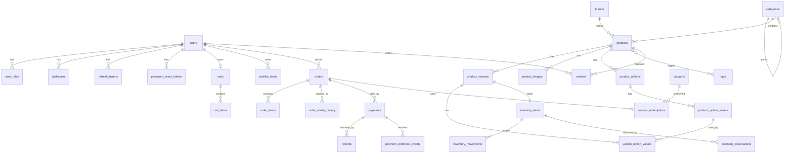

# Database Design (PostgreSQL)

Conventions:
- `snake_case`, plural table names.
- PK `id BIGINT` from a per-table sequence (`<table>_seq`, increment 50).
- Money: `<name>_minor BIGINT` + `currency CHAR(3)`.
- Timestamps: `TIMESTAMPTZ`, `created_at` / `updated_at` on every mutable table.
- Optimistic `version BIGINT` on aggregates edited by humans (products, coupons, orders).
- Cross-module FKs are allowed in the DB for integrity, but code references them by ID only.
- Every change is a Flyway migration in `backend/src/main/resources/db/migration`.

## Diagram



## Tables by module

### auth
| Table | Key columns |
|---|---|
| `users` | email (unique, citext), password_hash, first_name, last_name, status (ACTIVE/LOCKED/DISABLED), email_verified, version |
| `user_roles` | user_id, role (CUSTOMER/ADMIN/CATALOG_MANAGER/OPERATIONS) — PK(user_id, role) |
| `addresses` | user_id, label, full_name, line1, line2, city, region, postal_code, country (CHAR(2)), phone, is_default |
| `refresh_tokens` | user_id, token_hash (unique), family_id, expires_at, revoked_at, replaced_by_id |
| `password_reset_tokens` | user_id, token_hash (unique), expires_at, used_at |
| `audit_log` (common) | actor_user_id, action, resource_type, resource_id, ip, user_agent, details JSONB, created_at |

### category / catalog
| Table | Key columns |
|---|---|
| `categories` | parent_id, name, slug (unique), description, position, is_active |
| `brands` | name, slug (unique), logo_url |
| `products` | slug (unique), name, short_description, description, brand_id, category_id, status (DRAFT/PUBLISHED/ARCHIVED), currency, rating_avg NUMERIC(3,2), review_count, search_vector TSVECTOR (GIN), published_at, version |
| `product_variants` | product_id, sku (unique), price_minor, compare_at_price_minor, is_active, position, version |
| `product_options` | product_id, name (e.g. Color), position |
| `product_option_values` | option_id, value (e.g. Black), position |
| `variant_option_values` | variant_id, option_value_id — PK(both) |
| `product_images` | product_id, variant_id (nullable), url, alt_text, position |
| `tags` / `product_tags` | name, slug / product_id, tag_id |

Price lives on the **variant** (sizes/colors can differ); listing shows the product's min variant price.

### inventory
| Table | Key columns |
|---|---|
| `inventory_items` | variant_id (unique), on_hand, reserved, sold, low_stock_threshold, updated_at. **CHECK (reserved >= 0 AND on_hand >= 0 AND reserved <= on_hand)** |
| `inventory_reservations` | variant_id, order_id, quantity, status (ACTIVE/COMMITTED/RELEASED), expires_at — unique(order_id, variant_id) |
| `inventory_movements` | variant_id, type (RESTOCK/ADJUSTMENT/RESERVE/RELEASE/COMMIT/RETURN), quantity_delta, reason, reference, actor_user_id, created_at |

`available = on_hand - reserved`.

### cart / wishlist
| Table | Key columns |
|---|---|
| `carts` | user_id (unique, nullable), guest_token (unique, nullable), coupon_code, expires_at, version |
| `cart_items` | cart_id, variant_id, quantity — unique(cart_id, variant_id). **No price stored** — always recomputed |
| `wishlist_items` | user_id, product_id, created_at — unique(user_id, product_id) |

### order
| Table | Key columns |
|---|---|
| `orders` | order_number (unique, `CX-10001`), user_id, status, currency, subtotal_minor, discount_minor, shipping_minor, tax_minor, total_minor, coupon_code, shipping_address JSONB (snapshot), shipping_method, placed_at, version |
| `order_items` | order_id, variant_id, product_name, variant_label, sku, unit_price_minor, quantity, line_total_minor (snapshots) |
| `order_status_history` | order_id, from_status, to_status, reason, actor_user_id, created_at |

### payment
| Table | Key columns |
|---|---|
| `payments` | order_id, provider, provider_reference (unique per provider), status (PENDING/REQUIRES_ACTION/SUCCEEDED/FAILED/CANCELLED), amount_minor, currency, failure_reason, version |
| `refunds` | payment_id, provider_reference, amount_minor, status, reason |
| `payment_webhook_events` | provider, provider_event_id — **unique(provider, provider_event_id)** for dedup, payload JSONB, processed_at |

### promotion
| Table | Key columns |
|---|---|
| `coupons` | code (unique, upper), type (PERCENTAGE/FIXED), value, min_order_minor, starts_at, ends_at, usage_limit, used_count, per_customer_limit, is_active, version |
| `coupon_products` / `coupon_categories` | restriction join tables |
| `coupon_redemptions` | coupon_id, user_id, order_id (unique), created_at |

### review
| Table | Key columns |
|---|---|
| `reviews` | product_id, user_id, order_id, rating (1–5 CHECK), title, comment, verified_purchase, status (PENDING/APPROVED/REJECTED), moderated_by, moderated_at — unique(product_id, user_id) |

### common (cross-cutting)
| Table | Key columns |
|---|---|
| `idempotency_keys` | idem_key, user_id, operation, request_hash, status (IN_PROGRESS/COMPLETED), response_status, response_body JSONB, created_at, expires_at — unique(user_id, operation, idem_key) |
| `outbox_events` | aggregate_type, aggregate_id, event_type, payload JSONB, created_at, published_at, attempts, last_error — partial index on unpublished |

## Planned migrations (by phase)

```text
V1__baseline.sql                     Phase 1  (idempotency_keys, audit_log)
V2__create_users.sql                 Phase 2
V3__create_categories_brands.sql     Phase 3
V4__create_products.sql              Phase 3
V5__create_inventory.sql             Phase 4
V6__create_carts_wishlist.sql        Phase 5
V7__create_orders.sql                Phase 6
V8__create_payments.sql              Phase 7
V9__create_coupons.sql               Phase 8
V10__create_reviews.sql              Phase 8
V11__create_outbox.sql               Phase 9
```
